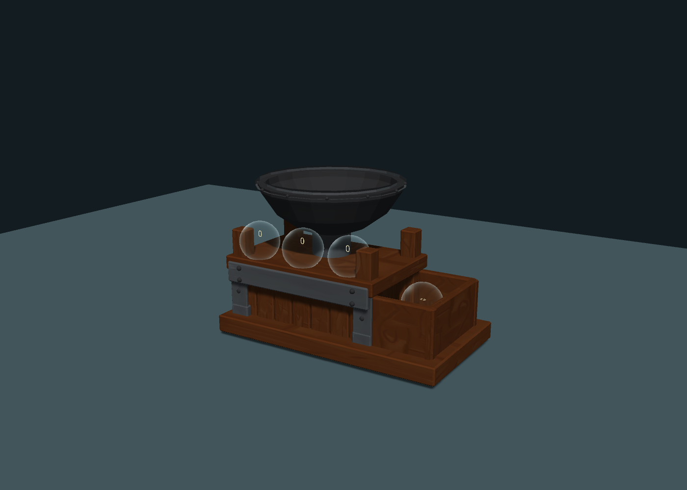

# Assembler for A Township Tale

A top-loading arrow assembler for the PC version of A Township Tale, using MelonLoader and SyncLib. Drop loose ingredients or bags into the hopper; native storage bubbles hold the inputs and the completed arrows.

**[Download the latest release](https://github.com/calebv2/assembler/releases/latest)** — install the client DLL on the client and the server DLL on the server. The Unity model, materials and sound are embedded in each DLL.



## Installation

1. Install compatible MelonLoader and SyncLib versions on both client and server.
2. Close both applications and download `Assembler-Mod-0.1.15.zip` from Releases.
3. Copy `Client/Mods/ArrowAssembler.dll` to the client's `Mods` folder.
4. Copy `Server/Mods/ArrowAssembler.dll` to the server's `Mods` folder.
5. Replace old copies rather than keeping duplicate DLLs. Preserve existing SyncLib and `modHashIds.json` files. Start the server, then the client.

Spawn from the server console:

```text
spawn "PlayerName" ArrowAssembler
```

Use `spawn find ArrowAssembler` to check registration. The prefab name is **ArrowAssembler**.

## Using the machine

The input order is **shaft → feather/fletching → tip/spike**. Drop singles or ingredient bags into the top hopper. Each bubble stores one ingredient type at a time, so whole feathers and cut fletching cannot occupy the feather bubble together. Ingredients can be retrieved from the native bubbles.

One shaft, one feather or fletching, and one compatible tip make one arrow in **three seconds**. The bowl rattles, the side gear turns, and a clunk accompanies completion. Finished arrows go to the separate output bubble. Crafting runs on the server.

| Input | Supported items |
| --- | --- |
| Shaft | `29772` ArrowShaftWooden |
| Fletching | `50608` SpriggullFletchingBlue; `24072` SpriggullFletchingRed |
| Whole feather | Spriggull Feather Blue or Red; one feather substitutes for one fletching |
| Tip/spike | `7092` CrystalShardBlue; `61488` SmallBoneSpike; `12492` SpikeFancy; `6934` SpikeShort; `3558` SpikeTall; `50412` ExplosiveSpike; `44360` HealingPod |

## Build from source

Requirements:

- Windows and PowerShell 5.1 or newer.
- Unity **2020.3.23f1**, including Windows build support. The build uses Unity's bundled C# compiler.
- A local PC game installation with `A Township Tale_Data/Managed`.
- MelonLoader's `net35` assemblies in that installation and a compatible `SyncLib.dll`.

Clone the repository, then run from its root:

```powershell
.\Build.ps1 -GamePath 'D:\Games\A Township Tale' -SyncLib 'D:\Games\A Township Tale\Mods\SyncLib.dll'
```

If Unity is installed elsewhere, add `-UnityPath 'D:\Unity\2020.3.23f1\Editor\Unity.exe'`. Close this project in Unity before using the command-line build.

The script exports the model bundle, compiles both roles, checks native field contracts and embedded assets, then creates:

```text
dist/Assembler-Mod-0.1.15.zip
dist/SHA256SUMS.txt
```

The game assemblies, MelonLoader and SyncLib are build inputs supplied by your installations; they are not committed or copied into the release. Package checks do not replace an in-game multiplayer test against your game and SyncLib versions.

### Edit the model

Open this repository as a Unity project. Edit `Assets/Assembler/AssemblerBowlDemo.unity`, save it, and choose **Assembler → Export Model Bundle (not game logic)**. Export strips preview scripts, labels, lights and cameras, regenerates solid collision, and adds native integration anchors. Run `Build.ps1 -SkipModelExport` with the same dependency arguments to compile the exported model into the mod.

The scene's standalone preview is for model inspection; ATT inventory, crafting, networking and persistence are implemented in the native source.

## Source layout

| Path | Purpose |
| --- | --- |
| `NativeMod/Source` | Registration, native prefab setup, recipe validation, server crafting, networking, compiler and verification scripts |
| `Assets/Assembler/Runtime` | Shared mechanical animation and completion sound logic |
| `Assets/Assembler/Editor/AssemblerExport.cs` | Explicit scene-to-model export |
| `Assets/Assembler` | Current editable scene, prefab and referenced meshes, materials, textures, shaders and audio |
| `Packages`, `ProjectSettings` | Unity dependencies and project configuration |
| `Build.ps1` | Complete export, compile, verify and package workflow |

## Troubleshooting

- **Prefab missing:** check both sides for `ASSEMBLER_STARTUP`, `ASSEMBLER_MODEL_READY`, and registration errors. Confirm role DLLs and SyncLib versions match.
- **Ingredient rejected:** check the supported list and whether that bubble already contains a different item type.
- **Build fails:** inspect `dist/Unity-export.log`; confirm the Unity version and dependency paths. Native contract failures can indicate a different game API version.
- **Report a problem:** include mod/game/SyncLib versions, steps to reproduce, and relevant client/server log excerpts. Remove account tokens before posting logs.

Mod by caleb. See [asset credits](docs/ASSETS.md).
